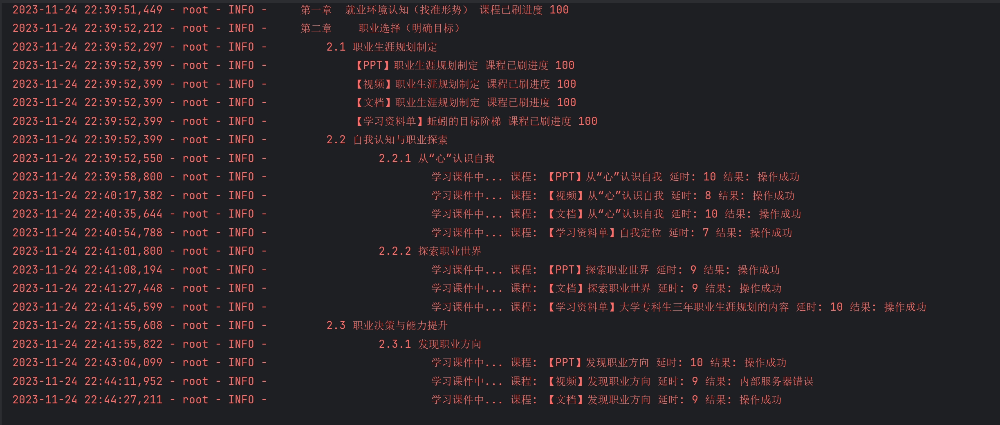

<div align="center">

# 🚀 ZJY 助手 - 学习管理工具

[](https://github.com/11273/zjy-work-answer/stargazers) [](https://www.python.org/downloads/) []()

**🎯 学习管理助手，帮助您更好地管理在线课程**

</div>

---

## 🌟 功能特色

### 🔐 双重登录模式

- **🆕 OAuth 浏览器登录**：安全便捷，支持现代化 Web 认证流程
- **🔒 传统账密登录**：兼容经典登录方式，满足不同用户需求

### 🎯 课程管理功能

- **📚 课程检测**：识别可用课程列表
- **🎛️ 选择性处理**：支持跳过指定课程，灵活控制处理范围
- **🔄 断点续学**：意外中断后可继续之前的处理进度

### 🛡️ 安全稳定

- **🔐 隐私保护**：本地运行，数据安全可控
- **⚡ 高性能**：优化的网络请求和资源管理
- **🛠️ 异常处理**：完善的错误处理和恢复机制

---

## 🚀 快速开始

### 方式一：发行版下载（推荐）

- 最新版下载 [Download exe 绿色运行版 >>>](https://github.com/11273/zjy-work-answer/releases/tag/v1.3.0)
- 历史版本下载 [请前往>>>](https://github.com/11273/zjy-work-answer/releases)

### 方式二：源码运行

```bash
# 1. 克隆项目
git clone https://github.com/11273/zjy-work-answer.git
cd zjy-work-answer

# 2. 安装依赖
pip install -r requirements.txt

# 3. 运行程序
python StartWork.py
```

---

## 📖 使用指南

### 🎯 启动程序

```bash
python StartWork.py
```

### 🔐 选择登录方式

程序启动后会显示登录选择界面：

```
============================================================
🚀 ZJY助手登录服务
============================================================
请选择登录方式：
1. 用户名密码登录（传统方式）
2. OAuth浏览器登录（推荐）
============================================================
```

#### 方式 1️⃣：OAuth 登录（推荐）

1. **选择选项 2**
2. **自动打开浏览器**：程序会自动打开智慧职教登录页面
3. **完成登录**：在浏览器中正常登录您的账号
4. **自动回调**：登录成功后页面会显示成功信息并自动处理
5. **继续使用**：返回程序界面继续操作

#### 方式 2️⃣：传统登录

1. **选择选项 1**
2. **输入账号**：输入您的用户名
3. **输入密码**：输入您的密码
4. **登录验证**：程序自动处理登录流程

### 🔄 处理流程

程序会按以下步骤执行：

1. **📋 获取课程列表**：检测账号下的所有课程
2. **🎯 课程筛选**：根据设置跳过指定课程
3. **▶️ 开始处理**：按流程处理选中的课程
4. **📊 进度显示**：实时显示处理进度和状态
5. **✅ 完成提示**：所有课程处理完成后显示结果

---

## ⚙️ 功能说明

### ⚠️ 注意事项

- **📚 学习目的**：仅供学习交流使用，请遵守平台规定
- **🔒 账号安全**：建议使用 OAuth 登录，更加安全
- **⚖️ 合规使用**：请确保使用行为符合相关法律法规
- **⏰ 合理使用**：请合理安排使用时间，避免异常

---

### 🆘 获取帮助

如果遇到其他问题，请：

1. **📋 查看日志**：检查程序运行日志了解具体错误
2. **🔍 搜索 Issues**：在 GitHub Issues 中搜索类似问题
3. **💬 提交 Issue**：[创建新 Issue](https://github.com/11273/zjy-work-answer/issues/new) 并提供：
   - 详细的错误信息
   - 运行环境信息
   - 复现步骤
   - 相关截图

---

### 🔧 技术特点

- **🏛️ 模块化设计**：清晰的模块分离，便于维护和扩展
- **🔐 安全认证**：支持现代 OAuth 2.0 认证流程
- **⚡ 异步处理**：优化的网络请求和资源管理
- **🛡️ 异常处理**：完善的错误处理和恢复机制
- **📊 日志系统**：详细的运行日志和调试信息

---

## 🎬 效果展示

### 🖥️ 程序界面



### 🔐 OAuth 登录流程

OAuth 登录提供了现代化的 Web 登录体验：

1. **🌐 自动打开浏览器**：无需手动输入网址
2. **🎨 美观的登录界面**：现代化的 UI 设计
3. **🔒 安全的认证流程**：标准 OAuth 2.0 流程
4. **✨ 成功页面反馈**：清晰的状态提示

_随着版本迭代，实际输出内容可能有所不同，请以最新版本为准_

---

## 🤝 贡献指南

### 🎯 如何贡献

我们欢迎任何形式的贡献！您可以：

- **🐛 报告 Bug**：发现问题请提交 Issue
- **💡 功能建议**：提出新功能想法
- **📝 代码贡献**：提交 Pull Request
- **📖 文档完善**：改进文档和说明
- **🌍 多语言支持**：添加国际化支持

### 🔧 开发环境设置

```bash
# 1. Fork并克隆项目
git clone https://github.com/yourusername/zjy-work-answer.git
cd zjy-work-answer

# 2. 创建开发分支
git checkout -b feature/your-feature-name

# 3. 安装开发依赖
pip install -r requirements.txt

# 4. 进行开发和测试

# 5. 提交更改
git add .
git commit -m "Add: your feature description"
git push origin feature/your-feature-name

# 6. 创建Pull Request
```

### 📋 代码规范

- 遵循 PEP 8 Python 代码规范
- 添加适当的注释和文档字符串
- 编写单元测试覆盖新功能
- 确保代码向后兼容

---

## ⚖️ 免责声明

### 🎓 使用目的

**⚠️ 重要声明：本项目仅供学习交流使用，旨在帮助用户更好地管理在线课程学习过程，严禁将其用于任何商业用途。**

### 📋 使用限制

- **🎯 学习辅助**：项目设计初衷是辅助学习管理，不得用于商业盈利
- **📚 数据来源**：所有接口数据均来源于相关在线教育平台
- **🔒 用户责任**：使用本工具所产生的任何后果由用户自行承担
- **⚖️ 法律合规**：请确保使用行为符合相关法律法规和平台规定

### 🛡️ 隐私保护

- **🔐 本地运行**：程序在本地运行，不收集用户个人信息
- **🔒 数据安全**：登录信息仅用于平台认证，不进行存储或传输
- **🌍 开源透明**：所有代码开源可审查，确保安全可靠

---

<div align="center">

### 🌟 如果这个项目对您有帮助，请给个 Star 支持一下！

[](https://github.com/11273/zjy-work-answer)

**📧 问题反馈** | **💬 讨论交流** | **🤝 贡献代码**

[提交 Issue](https://github.com/11273/zjy-work-answer/issues) • [查看 Releases](https://github.com/11273/zjy-work-answer/releases) • [Fork 项目](https://github.com/11273/zjy-work-answer/fork)

---

_🚀 ZJY 助手 - 让学习更高效 | 📚 开源免费 | 🎯 专注教育_

</div>
